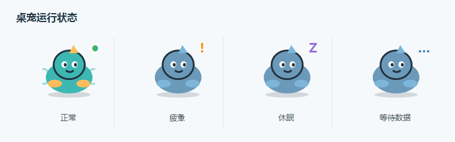
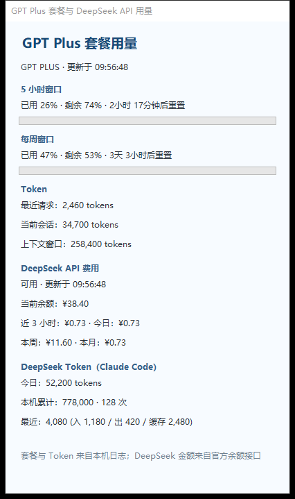

# QuotaPet

QuotaPet 是一个仅面向 Windows 的低帧率桌面宠物，用于查看本机 AI 服务额度与用量。
名字由 **Quota（额度）** 和 **Pet（宠物）** 组合而成。

目前只支持以下两类服务：

- **GPT Plus**：五小时额度、每周额度、重置时间与本机 Token 统计。
- **DeepSeek API**：账户余额、消费记录与 DeepSeek Token 使用量。

> QuotaPet 是个人项目，与 OpenAI、DeepSeek 均无官方关联。
>
> 当前不支持 Claude 模型。Claude Code 只作为本机 DeepSeek 调用记录的日志来源。

## 界面预览

### 桌宠运行状态

下图使用程序内置占位宠物绘制。公开仓库不包含本地自定义宠物素材。

<p align="center">
  
</p>

### 用量面板

面板截图使用示例数据，不包含真实账户余额、Token 或本机路径。

<p align="center">
  
</p>

## 功能

- 常驻桌面，可拖动，左键点击宠物打开或收起用量面板。
- 右键切换“全部显示”“仅 GPT Plus”“仅 DeepSeek”。
- 显示 GPT Plus 五小时和每周窗口的已用、剩余百分比与重置倒计时。
- 显示最近请求、当前会话和上下文窗口的 Token 数量。
- 每 5 分钟查询 DeepSeek 官方余额接口，并记录余额下降产生的消费。
- 显示 DeepSeek 近 3 小时、今日、本周和本月消费。
- 统计本机 Claude Code 日志中模型名以 `deepseek` 开头的调用 Token。
- 支持导入 DeepSeek 官方导出的费用 CSV 或 ZIP。
- 支持开机启动、暂停动画、隐藏宠物和打开本机数据目录。
- 前台应用全屏时自动暂停桌面动画，避免遮挡游戏或演示内容。
- 支持 4 帧活动动画与 4 帧空闲动画；缺少素材时自动使用内置占位宠物。

## 运行时状态

宠物的动作和右上角状态徽标分别表达不同信息。

| 状态 | 表现 | 触发条件 |
| --- | --- | --- |
| AI 活跃 | 播放 `swim` 四帧动画 | 最近 45 秒内发现新的本地用量事件 |
| AI 空闲 | 播放 `rest` 四帧动画 | 最近 45 秒内没有新的用量事件 |
| 正常 | 绿色 `●` | GPT 最低剩余额度高于 20%，或 DeepSeek 人民币余额高于 ¥10 |
| 疲惫 | 橙色 `!` | GPT 剩余额度在 5% 到 20% 之间，或 DeepSeek 余额在 ¥1 到 ¥10 之间 |
| 休眠 | 紫色 `Z` | GPT 额度耗尽、DeepSeek 不可用，或 DeepSeek 人民币余额低于 ¥1 |
| 等待数据 | 蓝色 `…` | 尚未读取到对应服务的用量数据 |

“全部显示”模式会取 GPT Plus 与 DeepSeek 中相对健康的状态。DeepSeek 未配置时，
该服务显示为等待数据。

动画被手动暂停，或前台应用进入全屏时，宠物会停在当前动作的第一帧。

## 右键菜单

- 显示内容：全部显示、仅 GPT Plus、仅 DeepSeek。
- 隐藏或重新显示宠物。
- 暂停或继续动画。
- 开启或关闭开机启动。
- 设置 DeepSeek API Key。
- 刷新 DeepSeek 余额。
- 打开 DeepSeek 官方用量页面。
- 导入 DeepSeek 官方费用 CSV 或 ZIP。
- 打开本机 Codex 用量数据目录。
- 退出 QuotaPet。

## 运行

### 从源码运行

需要 Windows 10/11 和 .NET 8 SDK：

```powershell
git clone git@github.com:Guys-code/QuotaPet.git
cd QuotaPet
dotnet run --project src\QuotaPet.App -c Release
```

### 构建独立发布版

```powershell
powershell -ExecutionPolicy Bypass -File scripts\publish.ps1
```

脚本会生成自包含的 `win-x64` 版本到仓库同级的 `QuotaPet-deploy\win-x64` 目录。
目标电脑不需要另外安装 .NET 8 Desktop Runtime。双击 `QuotaPet.App.exe` 即可运行。

脚本只会复制本机已有的 `pet*.png` 到发布目录。公开仓库本身不包含这些图片。

## DeepSeek 设置

1. 右键宠物，选择“设置 DeepSeek API”。
2. 粘贴 API Key 并保存。
3. 密钥保存在当前 Windows 用户的凭据管理器中，不写入设置文件。
4. 首次查询会建立余额记录起点，之后余额减少的部分会记录为消费。

DeepSeek 余额接口只提供当前余额，不提供 API Key 的历史账单。程序可导入开放平台导出的
`cost-*.csv`，或包含这些文件的 ZIP，补齐历史费用。重复导入相同记录会自动去重。

## 自定义宠物素材

公开仓库不包含任何宠物图像。程序读取以下 8 张动画帧：

```text
src\QuotaPet.App\Assets\pet-swim-1.png
src\QuotaPet.App\Assets\pet-swim-2.png
src\QuotaPet.App\Assets\pet-swim-3.png
src\QuotaPet.App\Assets\pet-swim-4.png
src\QuotaPet.App\Assets\pet-rest-1.png
src\QuotaPet.App\Assets\pet-rest-2.png
src\QuotaPet.App\Assets\pet-rest-3.png
src\QuotaPet.App\Assets\pet-rest-4.png
```

素材规格：

- PNG，透明背景，112 x 112 像素。
- 主体居中，四周保留约 8 像素留白。
- 同一角色在 8 帧中保持比例、配色和轮廓一致。
- `swim` 用于 AI 活跃状态，`rest` 用于 AI 空闲状态。
- 建议使用纯透明或完全不透明的二值 Alpha，便于边缘检查。

可以使用任意图像生成工具制作原创角色。下面的提示词可作为起点，并把括号内容替换成自己的设定：

```text
Create an original 112x112 pixel-art companion pet sprite frame.
Character: [your original character description and colors].
Pose: [swimming or resting, frame 1 of 4].
Style: clean pixel art, consistent palette, full body, centered,
transparent background, 8 px padding, no text, no watermark,
no copyrighted or trademarked character, no background scenery.
Keep the character proportions and outline consistent across all frames.
```

接入方式：

1. 把 8 张帧图放入 `src\QuotaPet.App\Assets`。
2. 从源码运行时，重新执行 `dotnet run`。
3. 使用发布版时，把图片放入可执行文件旁边的 `Assets` 文件夹并重启程序。
4. 可以额外保留 `pet.png`、`pet-source.png` 和 `pet-animation-sheet.png` 作为本地设计源图；
   运行时只读取上述 8 个动画帧。

缺少任意一帧时，程序会显示内置占位宠物，不会崩溃。

所有 `src\QuotaPet.App\Assets\*.png` 已在 `.gitignore` 中排除，只保留在本机。请不要为了公开
仓库而删除本地素材；Git 只是不会提交这些文件。

发布前可检查素材：

```powershell
python scripts\verify-sprite-alpha.py
```

检查内容包括文件名、尺寸、二值 Alpha 和每帧主体连通性。没有自定义素材时，脚本会提示程序
将使用内置占位宠物。

请只生成或分发原创角色，或确保你拥有相应公开分发权。不要使用受版权、商标或其他第三方权利
保护的知名角色素材。

## 数据与隐私

- GPT Plus 用量来源：`%USERPROFILE%\.codex\sessions` 中的 Token 事件。
- DeepSeek Token 来源：`%USERPROFILE%\.claude\projects` 中匹配 `deepseek` 的记录。
- 设置路径：`%LOCALAPPDATA%\QuotaPet\settings.json`。
- DeepSeek API Key：Windows 凭据管理器，目标名 `QuotaPet.DeepSeekApiKey`。
- 程序不读取 OpenAI 的 `auth.json`、Cookie 或对话正文。
- 程序不启动本地网络服务，也不向第三方上传日志。
- DeepSeek API Key 只发送给 `https://api.deepseek.com/user/balance`。
- README 截图使用内置占位宠物和示例数据，不包含真实账户信息。
- 本地宠物 PNG、构建产物和临时目录均不会进入公开仓库。

## 已知限制

- 仅支持 Windows。
- 仅支持 GPT Plus 套餐用量和 DeepSeek API 用量，不支持其他 AI 模型套餐。
- 远程设备或其他电脑产生的数据，必须同步到本机日志后才能显示。
- DeepSeek 历史费用需要从开放平台导出后手动导入。
- DeepSeek Token 只覆盖本机仍保留在 Claude Code 日志中的调用。
- DeepSeek 余额变化最多每 5 分钟采样一次，因此消费记录是采样结果。
- 没有自定义素材时，动画使用代码绘制的通用占位宠物。

## 开发与测试

```powershell
dotnet test QuotaPet.sln -c Release
dotnet build QuotaPet.sln -c Release
powershell -ExecutionPolicy Bypass -File scripts\publish.ps1
```

如果 `dotnet test` 因本机 workload 组件异常退出，可以直接调用 SDK 内的测试执行器。

## 许可

源代码和仓库内的文档展示图采用 MIT License。用户自行制作、生成或引入的宠物图像、角色设计和
其他第三方素材不在 MIT License 覆盖范围内，除非文件所属者另有书面说明。
